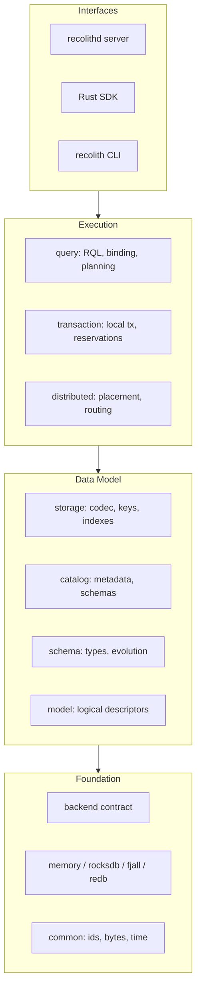

# RecolithDB

**RecolithDB is a game-backend NoSQL database that treats documents as schema-defined fragments: reads load only what is needed, and writes commit with local ACID.**

RecolithDB targets latency-sensitive online game workloads such as player profiles, inventories, mail, guilds, and trading. Instead of opaque JSON documents, records are bound to explicit schemas and document fragments map onto co-partitioned buckets. A point read touches a bounded set of records, and a multi-fragment document write is one local transaction.

## Design Pillars

- **Schema-first.** Every bucket has a versioned record schema. There is no untyped document drift, and indexes are defined over field IDs.
- **Fragment-native reads.** A document is a virtual aggregate. Queries declare included fragments, so the engine never hydrates the whole document by default.
- **Local ACID writes.** Co-located fragments commit with one commit timestamp. Optimistic checks use `if_match`; there is no silent escalation to a distributed transaction.
- **Partition-local indexes.** Index keys are scoped by bucket and partition, support equality lookup, and stay consistent with record writes in the same transaction.
- **Pluggable storage.** The ordered transactional KV backend contract requires snapshots, atomic multi-key commits, write-write conflict detection, ordered scans, and crash recovery.
- **Explicit distribution.** Placement, affinity groups, and partition routing are modeled from the start. Cross-partition operations use explicit workflows rather than hidden 2PC.
- **Crash-safe metadata.** Catalog generations, schemas, placements, and index definitions persist atomically and are validated on load.

## Architecture



## Workspace

| Crate | Responsibility |
|---|---|
| `crates/common` | Typed identifiers, errors, URI, byte and time utilities |
| `crates/model` | Keyspace, collection, fragment, bucket, document key, record and index descriptors |
| `crates/schema` | Type system, record IDL, validation, and compatibility rules |
| `crates/catalog` | Metadata, schema registry, placements, index definitions, generations, persistence |
| `crates/backend` | Ordered transactional KV contract, snapshots, capabilities, key ranges |
| `crates/backend-memory` | In-memory snapshot backend with conflict detection |
| `crates/backend-fjall` | Fjall LSM backend with optimistic transactions and stable snapshots |
| `crates/backend-rocksdb`, `crates/backend-redb` | Additional persistent backend adapters (scaffolds) |
| `crates/backend-conformance` | Reusable black-box backend contract suite |
| `crates/storage` | Record framing and codec, key and index encoding, document assembly |
| `crates/transaction` | Local transactions, batch writes, unique reservations, commit clock |
| `crates/query` | RQL parser and binder, query IR, planning, indexed execution |
| `crates/distributed` | Membership, routing, replication, rebalancing, migration |
| `crates/protocol` | Fixed frame header, batch and compression codecs, Protobuf v1 messages |
| `crates/security` | Opaque HMAC tokens, role files, collection-scoped permissions |
| `crates/platform` | OS I/O integration, Unix sockets, named pipes, service hooks |
| `crates/server` | Composition root, in-process document service, and the `recolithd` binary |
| `crates/client` | Rust transport client with TLS, negotiation, and typed operations |
| `crates/cli` | `recolith` command-line client |
| `crates/testkit` | Fixtures, deterministic simulation, fault injection |

## Status

RecolithDB is in early single-node development. Implemented today:

- Ordered transactional KV contract, copy-on-write in-memory backend, fjall persistent adapter, and a reusable conformance suite.
- Schema types, record IDL parser, compatibility classification, and catalog schema registry.
- Catalog metadata, index definitions, bucket placement, generations, and atomic persistence.
- Schema-aware field codec, record framing, partition-scoped record and index keys, CRC32C checks.
- Lazy one/many fragment assembly, equality and range index pushdown including composite leading fields, same-fragment multi-index intersection, and range filters.
- Local transactions, multi-fragment commits with one timestamp, optimistic `if_match`, unique reservation workflow, persistent commit clock.
- RQL document-query subset: parser, catalog binder, document key encoding, planner, and executor.
- In-process document service: catalog-bound multi-fragment writes, cardinality and partition validation, multi-fragment reads, and automatic index maintenance with sparse and unique indexes.
- Protocol frame layer: fixed 38-byte header, CRC32C, zstd/lz4 compression, BATCH codec, Protobuf v1 messages, and collection metadata lookup.
- TCP session layer: HELLO/WELCOME negotiation, bearer-token auth, compression selection, PING/PONG, BATCH dispatch, and structured errors.
- TLS 1.3 transport with rustls and typed Rust client handshake, authentication, document, query, batch, and collection-description calls.
- Runnable `recolithd` process with TOML configuration, memory or fjall storage, optional catalog bootstrap, persisted catalog reload, runtime catalog creation, TLS, bearer auth, logging, and graceful shutdown.
- `recolith` CLI with `ping`, RQL `query`, `describe`, schema-aware `doc get` / `doc put`, runtime `catalog` creation, file-based catalog apply, and drop commands, and local `token issue` / `token inspect` / `token verify`, including TLS, bearer auth, named keys and fields, and human-readable output.
- Protocol document and query operations: DOC_GET, idempotent DOC_PUT with same-transaction deduplication, and RQL QUERY execution.
- Process-exit crash recovery test and a full restart test covering catalog reload, commit-clock continuity, and persisted documents.
- Point read/write benchmark example for the fjall adapter.
- Batched commit-timestamp allocation, parallel document writes, and document plus concurrent multi-client benchmarks.
- Network robustness coverage: oversized, truncated, and corrupt frames, malformed batches, TLS rejection, and shutdown draining.
- Process-local server metrics for sessions, requests, errors, operation counts, and per-operation latency percentiles, logged periodically and at shutdown.
- Bounded concurrent sessions with connection-limit overload rejection and rejection metrics.
- HMAC-SHA256 opaque tokens, role-based collection permissions, token expiry, local token inspection and verification, and principal-scoped idempotency.
- Atomic catalog creation and removal for keyspaces, schema versions, buckets, collections, and indexes, with generation checks, purge controls, synchronous index backfill, and persisted reload.
- Offline logical backup, verification, and restore with checksums, entry-count validation, and bounded scan batches.

Not yet implemented:

- Benchmarks on the target hardware profile and compaction tuning.
- Additional persistent adapters (RocksDB, redb).
- Catalog alters, online backfill for very large buckets, and schema migration.
- Higher-level Rust SDK ergonomics, streaming result descriptors, and broader CLI administration.
- Distributed placement, replication, and cross-partition workflows.

## Quick Start

Start the example server:

```text
cargo run -p recolith-server --bin recolithd -- --config examples/recolithd/recolith.toml
```

In another terminal:

```text
cargo run -p recolith-cli --bin recolith -- ping
cargo run -p recolith-cli --bin recolith -- describe player --keyspace game
cargo run -p recolith-cli --bin recolith -- doc put --collection player --keyspace game --key player_id=u64:1 --idempotency-key demo-1 --field profile.name=string:alex --field profile.level=u32:10
cargo run -p recolith-cli --bin recolith -- doc get --collection player --keyspace game --key player_id=u64:1 --fragment profile
cargo run -p recolith-cli --bin recolith -- query "SELECT profile.name FROM player WHERE player_id = :id INCLUDE FRAGMENTS profile" --param id=u64:1
```

The example configuration and catalog are under [`examples/recolithd`](examples/recolithd). The bootstrap catalog is applied only when persistent metadata is empty; later starts reuse the stored catalog.

## Backup and Restore

Stop the server before taking or restoring a backup.

```text
cargo run -p recolith-server --bin recolith-backup -- backup --data-dir examples/recolithd/data --output game.backup
cargo run -p recolith-server --bin recolith-backup -- verify --input game.backup
cargo run -p recolith-server --bin recolith-backup -- restore --data-dir restored-data --input game.backup
```

Restore requires an empty target directory. Switch the server data path to the restored directory after verifying it.

## Authentication

Authentication is disabled by default for loopback development. To enable token authentication, generate a secret and uncomment the `[auth]` section in the example configuration:

```text
openssl rand -hex 32 > examples/recolithd/secret.hex
```

```toml
[auth]
secret_file = "secret.hex"
roles_file = "roles.toml"
```

Issue a token locally:

```text
cargo run -p recolith-cli --bin recolith -- token issue --secret-file examples/recolithd/secret.hex --subject admin --role admin --ttl 3600
```

Inspect claims or verify a token signature locally, without contacting a server:

```text
cargo run -p recolith-cli --bin recolith -- token inspect --token-file token.txt
cargo run -p recolith-cli --bin recolith -- token verify --secret-file examples/recolithd/secret.hex --token-file token.txt
```

`token inspect` decodes claims without checking the signature and is intended for diagnostics. `token verify` checks the signature and expiry; pass `--previous-secret-file` while rotating secrets.

Then pass the token to commands:

```text
cargo run -p recolith-cli --bin recolith -- --token "$RECOLITH_TOKEN" ping
```

Roles grant `read`, `write`, `describe`, or `admin` actions over keyspace/collection scopes. Role changes apply after restart. `DOC_GET` and `QUERY` require `read`; `DOC_PUT` requires `write`; `DESCRIBE_COLLECTION` requires `describe`. The example `roles.toml` includes `admin`, `game-reader`, and `game-writer` roles. `CATALOG_APPLY` requires `admin` on every affected scope; schema registration requires global admin on `*/*`.

## Catalog Changes

Without a bootstrap file, the server starts with an empty catalog. A complete catalog definition file can be applied atomically:

```text
cargo run -p recolith-cli --bin recolith -- catalog apply --file examples/recolithd/catalog.toml
```

The file uses the same format as `catalog.bootstrap`. Every object is validated before anything is persisted; identical objects are idempotent and conflicting definitions return `CONFLICT`.

Individual objects can also be created at runtime:

```text
cargo run -p recolith-cli --bin recolith -- catalog create-keyspace --id 1 --name game
cargo run -p recolith-cli --bin recolith -- catalog register-schema --id 1 --version 1 --idl-file profile.idl
cargo run -p recolith-cli --bin recolith -- catalog create-bucket --id 1 --keyspace-id 1 --name player_profile --partitions 16 --schema-id 1 --schema-version 1
cargo run -p recolith-cli --bin recolith -- catalog create-collection --id 1 --keyspace-id 1 --name player --key player_id:u64 --fragment 1:profile:1:one
cargo run -p recolith-cli --bin recolith -- catalog create-index --bucket-id 1 --id 1 --name by-level --kind range --field 2
```

Identifiers are assigned by the client. Each command sends one `CATALOG_APPLY` request, which is validated and persisted atomically. Reapplying an identical definition succeeds without changing the catalog; conflicting definitions return `CONFLICT`. Pass `--catalog-generation N` to reject the change when the server has moved past generation `N`.

New indexes backfill existing records in the same transaction that persists the catalog. Backfill is limited to 100,000 records or 64 MiB; larger buckets return `FAILED_PRECONDITION`.

Catalog objects are removed with `catalog drop-*`:

```text
cargo run -p recolith-cli --bin recolith -- catalog drop-index --bucket-id 1 --index-id 1 --purge
cargo run -p recolith-cli --bin recolith -- catalog drop-collection --id 1 --purge
cargo run -p recolith-cli --bin recolith -- catalog drop-bucket --id 1 --purge
cargo run -p recolith-cli --bin recolith -- catalog drop-keyspace --id 1 --purge
```

Non-empty targets require `--purge`; without it they return `FAILED_PRECONDITION`. Purge deletes records and index entries in bounded batches before the catalog snapshot is committed. A crash during purge leaves the object visible, so the drop can be retried. Dropping a collection or keyspace is rejected while its buckets are shared with another collection. Keyspace drops cascade their collections, buckets, indexes, and placements; schemas remain because they are shared.

Catalog alters are not implemented yet.

## Build

Requires Rust 1.90 or newer (edition 2024). Building the protocol crate requires `protoc`.

```text
cargo build --workspace
cargo test --workspace --all-targets
cargo fmt --all --check
cargo clippy --workspace --all-targets -- -D warnings
```

## Benchmarks

```text
cargo run --release -p recolith-backend-fjall --example point_bench
cargo run --release -p recolith-server --example document_bench
cargo run --release -p recolith-client --example server_bench
cargo run --release -p recolith-client --example soak
```

The server benchmark supports `BENCH_CLIENTS`, `BENCH_WRITES`, `BENCH_READS`, `BENCH_QUERIES`, `BENCH_RUNS`, and `BENCH_WARMUP`. The soak benchmark supports `SOAK_SECONDS` and `SOAK_CLIENTS`.

Generate API documentation with `cargo doc --workspace --no-deps --open`.

Tests live under each crate's `tests/` directory and use the public API; `src/` contains no test modules.

## License

Apache License 2.0. See [LICENSE](LICENSE).
