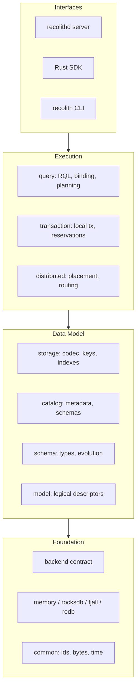

# RecolithDB

**RecolithDB is a game-backend NoSQL database that treats documents as schema-defined fragments: reads load only what is needed, and writes commit with local ACID.**

RecolithDB targets latency-sensitive online game workloads such as player profiles, inventories, mail, guilds, and trading. Instead of opaque JSON documents, records are bound to explicit schemas and document fragments map onto co-partitioned buckets. A point read touches a bounded set of records, and a multi-fragment document write is one local transaction.

## Design Pillars

- **Schema-first.** Every bucket has a versioned record schema. There is no untyped document drift, and indexes are defined over field IDs.
- **Fragment-native reads.** A document is a virtual aggregate. Queries declare included fragments, so the engine never hydrates the whole document by default.
- **Local ACID writes.** Co-located fragments commit with one commit timestamp. Optimistic checks use `if_match`; there is no silent escalation to a distributed transaction.
- **Partition-local indexes.** Index keys are scoped by bucket and partition, support equality lookup, and stay consistent with record writes in the same transaction.
- **Pluggable storage.** The ordered transactional KV backend contract requires snapshots, atomic multi-key commits, write-write conflict detection, ordered scans, and crash recovery.
- **Explicit distribution.** Placement, affinity groups, and partition routing are modeled from the start. Cross-partition operations use explicit workflows rather than hidden 2PC.
- **Crash-safe metadata.** Catalog generations, schemas, placements, and index definitions persist atomically and are validated on load.

## Architecture



## Workspace

| Crate | Responsibility |
|---|---|
| `crates/common` | Typed identifiers, errors, URI, byte and time utilities |
| `crates/model` | Keyspace, collection, fragment, bucket, document key, record and index descriptors |
| `crates/schema` | Type system, record IDL, validation, and compatibility rules |
| `crates/catalog` | Metadata, schema registry, placements, index definitions, generations, persistence |
| `crates/backend` | Ordered transactional KV contract, snapshots, capabilities, key ranges |
| `crates/backend-memory` | In-memory snapshot backend with conflict detection |
| `crates/backend-fjall` | Fjall LSM backend with optimistic transactions and stable snapshots |
| `crates/backend-rocksdb`, `crates/backend-redb` | Additional persistent backend adapters (scaffolds) |
| `crates/backend-conformance` | Reusable black-box backend contract suite |
| `crates/storage` | Record framing and codec, key and index encoding, document assembly |
| `crates/transaction` | Local transactions, batch writes, unique reservations, commit clock |
| `crates/query` | RQL parser and binder, query IR, planning, indexed execution |
| `crates/distributed` | Membership, routing, replication, rebalancing, migration |
| `crates/protocol` | Frames, sessions, transports, authentication, codecs |
| `crates/platform` | OS I/O integration, Unix sockets, named pipes, service hooks |
| `crates/server` | Composition root, in-process document service, and the `recolithd` binary |
| `crates/client` | Rust SDK |
| `crates/cli` | `recolith` command-line client |
| `crates/testkit` | Fixtures, deterministic simulation, fault injection |

## Status

RecolithDB is in early single-node development. Implemented today:

- Ordered transactional KV contract, in-memory backend, fjall persistent adapter, and a reusable conformance suite.
- Schema types, record IDL parser, compatibility classification, and catalog schema registry.
- Catalog metadata, index definitions, bucket placement, generations, and atomic persistence.
- Schema-aware field codec, record framing, partition-scoped record and index keys, CRC32C checks.
- Lazy one/many fragment assembly, equality-index pushdown, and range filters.
- Local transactions, multi-fragment commits with one timestamp, optimistic `if_match`, unique reservation workflow, persistent commit clock.
- RQL document-query subset: parser, catalog binder, document key encoding, planner, and executor.
- In-process document service: catalog-bound multi-fragment writes, cardinality and partition validation, multi-fragment reads, and automatic index maintenance with sparse and unique indexes.
- Process-exit crash recovery test and a full restart test covering catalog reload, commit-clock continuity, and persisted documents.
- Point read/write benchmark example for the fjall adapter.

Not yet implemented:

- Benchmarks on the target hardware profile and compaction tuning.
- Additional persistent adapters (RocksDB, redb).
- Network protocol, authentication, Rust SDK, and CLI.
- Distributed placement, replication, and cross-partition workflows.

## Build

Requires Rust 1.90 or newer (edition 2024).

```text
cargo build --workspace
cargo test --workspace --all-targets
cargo fmt --all --check
cargo clippy --workspace --all-targets -- -D warnings
```

Generate API documentation with `cargo doc --workspace --no-deps --open`.

Tests live under each crate's `tests/` directory and use the public API; `src/` contains no test modules.

## License

Apache License 2.0. See [LICENSE](LICENSE).
